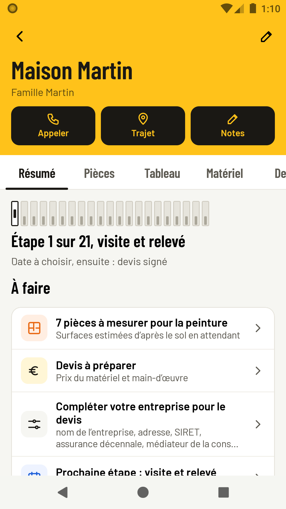
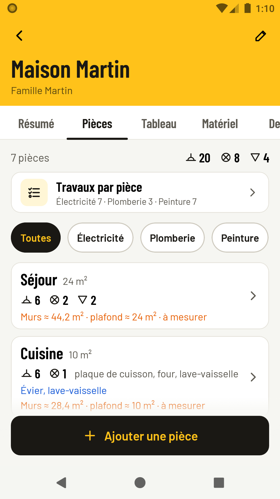
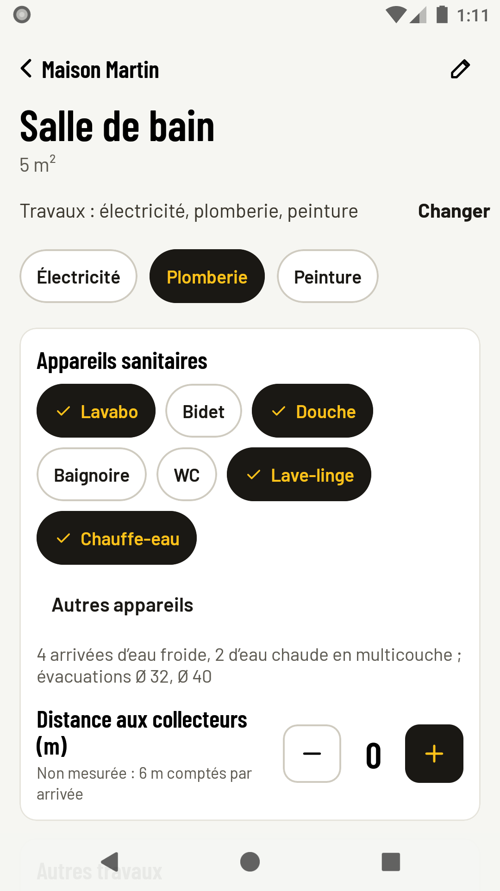
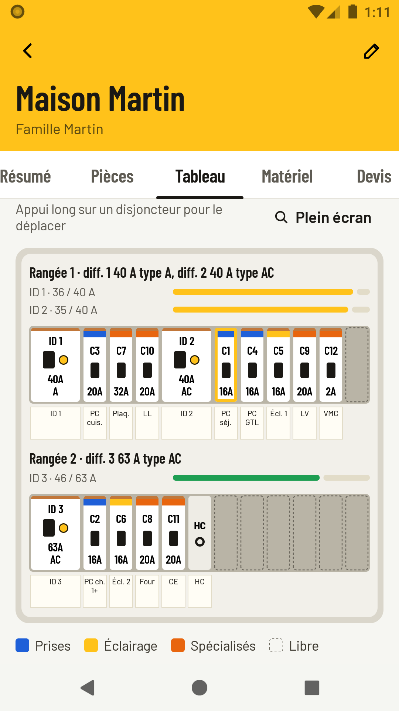
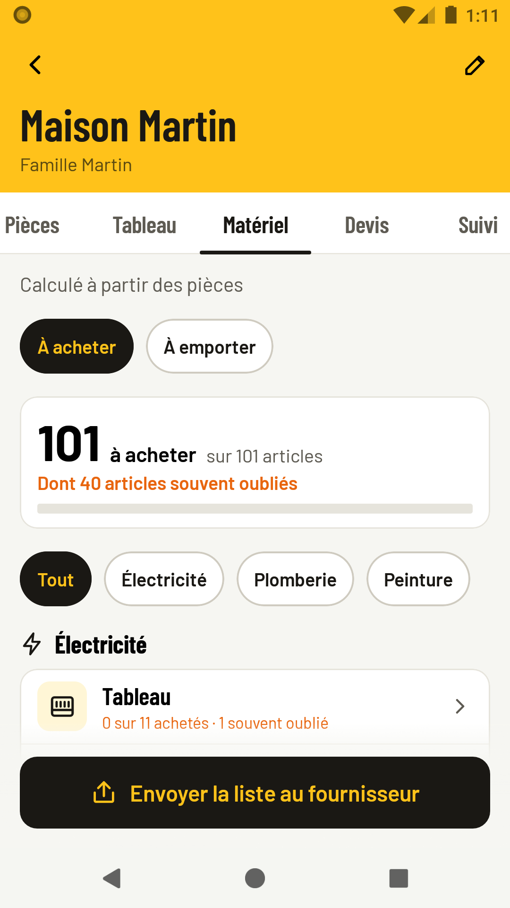

# Jalon — by dat00u

**Chaque étape jalonnée, rien d'oublié.**

Jalon est une application Android gratuite pour les artisans en **électricité, plomberie et peinture**. Elle aide à préparer et suivre un chantier sans rien oublier : pièces, tableau électrique, matériel, devis, factures, étapes et contrôles de fin de chantier.

**Tout reste sur votre téléphone.** Pas de compte, pas de serveur, pas de publicité. L'application marche sans réseau, et vous prévient elle-même quand une nouvelle version sort.

Version disponible : **1.1.0 · Android 8 et suivants · en français**. [Télécharger l'APK signée](https://github.com/dat00udev-sys/jalon-distribution/releases/download/v1.1.0/Jalon-1.1.0.apk). Aucun compte GitHub n'est nécessaire.

[Installer l'application](INSTALLATION.md) · [Nouveautés](CHANGELOG.md) · [Confidentialité](CONFIDENTIALITE.md)

## Ce que vous pouvez faire

| Écran | À quoi il sert |
|---|---|
| Création du chantier | Le client, le logement (T1 à T5), puis une grille : dans chaque pièce, électricité, plomberie, peinture, ou rien. Vos choix sont gardés pour le chantier suivant. |
| Pièces | Prises, points lumineux et RJ45 aux minimums de la NF C 15-100 ; prises doubles, triples et USB ; va-et-vient et télérupteurs ; appareils sanitaires ; surfaces à peindre ; photos ; « Autres travaux » (carrelage, placo…). |
| Tableau | Circuits, disjoncteurs, différentiels et coffret calculés à partir des pièces, dessinés comme au mur, avec les vérifications de la norme. Étiquettes, schéma unifilaire et dossier Consuel en PDF. |
| Matériel | La liste complète par famille, les articles « souvent oubliés » signalés, ce qui est déjà acheté replié ; les outils à emporter. La liste part au fournisseur par SMS ou e-mail. |
| Devis et factures | Un lot par métier, les prix gardés d'un chantier à l'autre, « Avez-vous pensé à… » avant d'émettre ; signature du client sur le téléphone ; factures d'acompte et de solde. |
| Suivi | Étapes de chaque métier, heures, réserves, fiche d'essais et contrôles avant la réception. |

Les règles de calcul suivent la NF C 15-100 (série 2024) et le NF DTU 60.11, d'après les guides publics des fabricants, de Promotelec, de la CAPEB et du Consuel. **C'est une aide : l'artisan reste seul juge de son installation.**

## Vos données restent sur le téléphone

Vos chantiers, clients, prix et photos restent dans l'espace privé de l'application. Ils ne quittent le téléphone que si vous envoyez un PDF, une liste ou une sauvegarde. La seule connexion de l'application est la lecture, à l'ouverture, du fichier `versions.json` de cette page, qui annonce les nouvelles versions : rien n'est envoyé. Voir la [politique de confidentialité](CONFIDENTIALITE.md).

## Télécharger et mettre à jour

Les APK signées sont dans les [Releases](https://github.com/dat00udev-sys/jalon-distribution/releases).

L'application vous prévient elle-même : un bandeau « Nouvelle version » apparaît sur l'accueil, avec « Mettre à jour », qui ouvre le téléchargement, et « Plus tard ». Installez la nouvelle version **par-dessus** l'ancienne, sans désinstaller : vos chantiers sont conservés. Réglages › Sécurité et sauvegarde › « Mises à jour » montre la version installée et vérifie à la demande.

Le fichier d'annonce `versions.json` est signé et ne contient aucune donnée personnelle.

Jalon s'appelait auparavant **Chantier Élec**, dans des versions d'essai non publiées : signées avec une autre clé, elles ne se mettent pas à jour directement. Faites une sauvegarde (Réglages › Sécurité et sauvegarde), désinstallez, installez Jalon, puis restaurez la sauvegarde.

## Besoin d'aide ?

Pour signaler un problème ou proposer une idée, ouvrez une [issue](https://github.com/dat00udev-sys/jalon-distribution/issues) en indiquant :
- la version de l'application (Réglages, en bas de l'onglet Sécurité et sauvegarde) ;
- le téléphone ;
- les étapes qui reproduisent le problème.

**Ne joignez jamais de données de vos clients.**
